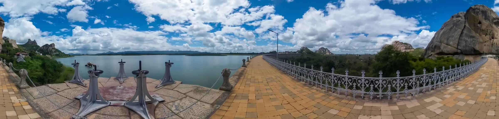
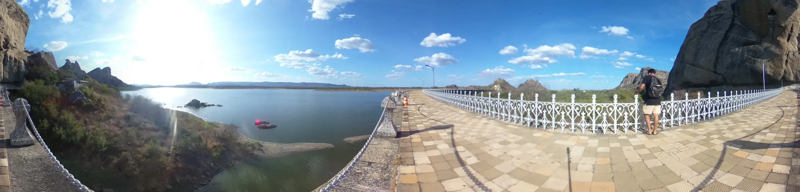

<p align="center">
  
</p>

<h1 align="center">Máquina do Tempo · Açude Cedro</h1>

<p align="center">
  O Açude Cedro, em Quixadá (CE), na chuva e na seca, direto no navegador do celular.
</p>

<p align="center">
  <a href="https://adrielmp44.github.io/MaquinaDoTempo2/"><strong>Abrir a aplicação →</strong></a>
</p>

<p align="center">
  
  
</p>

---

## Sobre o projeto

A paisagem do Açude Cedro muda ao longo do ano. Na quadra chuvosa, a vegetação fica verde e o açude enche; na estiagem, tudo seca e predominam os tons de terra. Quem visita o lugar vê só um desses estados.

A **Máquina do Tempo** mostra os dois. É uma aplicação web para celular, sem instalação, desenvolvida como Trabalho de Conclusão de Curso em Design Digital na Universidade Federal do Ceará, Campus Quixadá.

### Dois modos de uso

| | **Estou no Cedro** (presencial) | **Explorar de onde estou** (remoto) |
|---|---|---|
| Para quem | Quem está no açude | Quem está em qualquer outro lugar |
| O que acontece | A câmera mostra a paisagem de agora, e a foto 360° do mesmo ponto no outro período aparece por cima, com transparência ajustável | Um tour pelas fotos 360°, girando a visão com o dedo ou com o celular |
| Tecnologia | Realidade aumentada no navegador | Realidade virtual não imersiva |
| Como chegar | Código QR no banner da entrada do açude | Tela inicial |

### O que dá para fazer

- Trocar entre **chuva** e **seca** sem sair do ponto
- Ajustar a **transparência** da foto sobre a câmera (modo presencial)
- Realinhar a foto com o **Norte** pela bússola do celular
- Ir de um ponto a outro pelo **mapa**, pelas **setas** ou pelos **indicadores no chão** da foto
- Ler o cartão **"Você sabia?"**, com uma curiosidade sobre Quixadá, o Cedro, o clima ou a Caatinga em cada foto, sempre com a fonte
- Ligar ou desligar o **giroscópio**, as curiosidades e a **tela cheia** no menu

## O acervo fotográfico

São **8 pontos** espalhados pela área de visitação do açude, fotografados nas duas estações com o mesmo protocolo, para que as imagens possam ser sobrepostas:

| | |
|---|---|
| Câmera | Ricoh Theta Z1 (360°) |
| Período chuvoso | 10 de maio de 2026 |
| Período seco | 2 de outubro de 2026 |
| Tripé | Fixo a 1,30 m do chão |
| Orientação | Câmera voltada para o Norte, com bússola |
| Formato | RAW (mais de 40 MB cada) convertido para WebP, em 5376 × 2688 px |
| Tamanho final | De 0,7 a 2,3 MB por foto, cerca de 21 MB nas 16 fotos |

Como a direção registrada variou entre as duas capturas, a foto da seca de cada ponto recebe um ajuste de rotação, feito no modo de calibração (veja abaixo).

O protocolo é reproduzível. Novas capturas em outros anos podem entrar no acervo e transformar o projeto em uma série histórica da paisagem do açude.

## Tecnologias

- **[React](https://react.dev)** para a interface, com CSS Modules
- **[A-Frame](https://aframe.io)** para as cenas 360° (`<a-sky>` e `look-controls`)
- **[Vite](https://vite.dev)** para o build
- **[Lucide](https://lucide.dev)** para os ícones
- **GitHub Pages** para a hospedagem, com HTTPS, exigido pelos navegadores para liberar câmera e sensores

Para abrir rápido pelo código QR, a aplicação carrega o código da cena 360° só quando o primeiro ponto é aberto, e baixa apenas as duas fotos do ponto atual.

## Design system

A interface usa um design system próprio, em `src/design-system/`, com os mesmos valores no guia visual e no código: variáveis CSS (tokens), folha de estilos e dez componentes React (`Button`, `IconButton`, `SeasonToggle`, `OpacitySlider`, `Switch`, `Tag`, `HudFrame`, `GlassPanel`, `PointMarker` e `Logo`).

As decisões partem do uso real: ao ar livre, sob sol forte, muitas vezes com uma mão só.

- **Tema claro** por padrão, com contraste de texto acima de 4,5:1 (WCAG 2.2, nível AA)
- **Áreas de toque de 48 px** ou mais
- **Chuva em verde-água** (`#0E6A6A`) e **seca em laranja** (`#C2410C`), sempre com o nome escrito ao lado, nunca só pela cor
- **Tipografia:** Unbounded nos títulos, Atkinson Hyperlegible no texto e IBM Plex Mono em etiquetas, datas e números
- A paisagem fica em primeiro plano: os controles ficam embaixo, perto do polegar, e o topo fica livre

## Rodar o projeto

```bash
npm install
npm run dev          # http://localhost:5173/MaquinaDoTempo2/
npm run deploy       # build + publicação no GitHub Pages
```

A câmera só funciona em HTTPS. Para testar o modo presencial no celular, use o endereço publicado.

### Endereços

| | |
|---|---|
| Aplicação | https://adrielmp44.github.io/MaquinaDoTempo2/ |
| Código QR do banner (abre direto no modo presencial) | https://adrielmp44.github.io/MaquinaDoTempo2/?modo=presencial |
| Calibração (uso do autor) | acrescente `?calibrar` ao endereço |

## Estrutura

```
src/
├── components/       telas e partes da interface (Mapa, VisualizacaoPonto, ModoPresencial...)
├── data/
│   ├── pontos.js         dados de cada ponto
│   └── curiosidades.js   cartões "Você sabia?"
└── design-system/    tokens, estilos e componentes
public/
└── fotos360/         ponto-NN-chuva.webp e ponto-NN-seca.webp
```

### Onde mudar o conteúdo

- **Pontos:** tudo fica em `src/data/pontos.js`: nome, posição no mapa, datas, alinhamento e vizinhos. Para acrescentar um ponto ou corrigir uma posição, basta editar esse arquivo.
- **Fotos:** em `public/fotos360/`, com o nome `ponto-NN-chuva.webp` e `ponto-NN-seca.webp`.
- **Curiosidades:** em `src/data/curiosidades.js`, um texto para a chuva e outro para a seca em cada ponto, com a fonte.

## Calibração (`?calibrar`)

1. **Alinhar a seca com a chuva:** no modo "Explorar de onde estou", abra um ponto, marque "Seca por cima da chuva" e mova o controle até as duas fotos coincidirem. Copie o valor de `ajusteSeca` para o ponto em `pontos.js`.
2. **Indicadores no chão:** cada foto tem dois, um para avançar e outro para voltar. Toque no chão da foto, onde o indicador deve ficar, e o painel mostra a `posicao`. Copie para o item certo em `vizinhos`, no `pontos.js`. Sem calibrar, o de avançar fica à frente (`'0 -2 -6'`) e o de voltar, atrás (`'0 -2 6'`).
3. **Mapa:** na tela do mapa, toque no lugar do ponto e copie o `posicaoMapa`.

## Tempo de carregamento

Cada foto baixada é registrada no console (`[Máquina do Tempo] ponto-03-seca.webp em 2.4 s`) e fica em `window.__mtTempos`. A meta é carregar as fotos de um ponto em até 10 segundos no 4G.

## Créditos

**Carlos Adriel Roque Pires** ([@adrielmp44](https://github.com/adrielmp44)): projeto, fotografias, design e desenvolvimento.

Orientação: Prof. Dr. João Vilnei de Oliveira Filho.
Curso de Design Digital, Universidade Federal do Ceará (UFC), Campus Quixadá, 2026.

O Claude, da Anthropic, foi usado como apoio na escrita do código, nas propostas do design system e na pesquisa das curiosidades. As decisões de projeto, as fotografias e os testes são do autor. O detalhamento está no apêndice de declaração de uso de IA do TCC.
